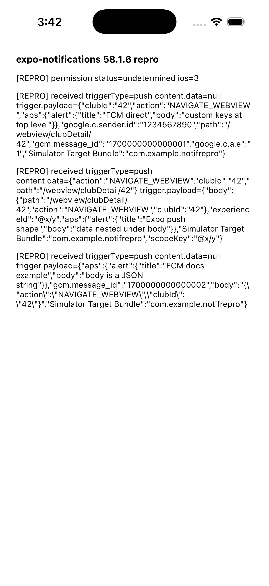

# expo-notifications iOS: `content.data` is `null` for FCM-direct remote notifications

Minimal reproduction for an `expo-notifications` bug on iOS.

On iOS, `notification.request.content.data` is `null` for a remote notification that has no `body` dictionary at the top level of the APNs payload. A notification sent directly through FCM has this shape, because FCM puts the `data` keys at the top level of the APNs payload. On Android, the same FCM message gives the custom keys in `content.data`.

The app is `create-expo-app --template blank-typescript` with `expo-notifications` added. `App.tsx` prints what `addNotificationReceivedListener` and `addNotificationResponseReceivedListener` receive.

## Versions

- expo 58.0.20, expo-notifications 58.1.6, react-native 0.88.0
- Xcode 26.2, iPhone 17 Pro simulator, iOS 26.2
- Node 22.22.3

## Steps

```sh
npm install
npx expo run:ios --configuration Release
```

Keep the app in the foreground. Then send each payload to the simulator:

```sh
xcrun simctl push booted com.example.notifrepro payloads/fcm-direct.apns
xcrun simctl push booted com.example.notifrepro payloads/expo-push.apns
xcrun simctl push booted com.example.notifrepro payloads/fcm-docs-example.apns
```

## Result

| Payload | Shape | `content.data` |
|---|---|---|
| `fcm-direct.apns` | What FCM delivers for `{ notification, data: { action, clubId, path } }`: custom keys at the top level | `null` |
| `expo-push.apns` | What the Expo push service delivers: custom keys in a `body` dictionary | `{ action, clubId, path }` |
| `fcm-docs-example.apns` | The FCMv1 example in the Expo docs: `body` is a JSON string | `null` |

In all three cases, `trigger.type` is `push` and `trigger.payload` contains the custom keys.



## Expected

`content.data` contains the custom keys, as on Android.

## Cause

For a `UNPushNotificationTrigger`, `NotificationContentRecord.serializedNotificationData` returns only `userInfo["body"] as? [String: Any]`:
[NotificationRecords.swift#L328-L334](https://github.com/expo/expo/blob/e70e9edece38af1d2bb76aa76b5a395ad56fb72c/packages/expo-notifications/ios/ExpoNotifications/Notifications/NotificationRecords.swift#L328-L334)
